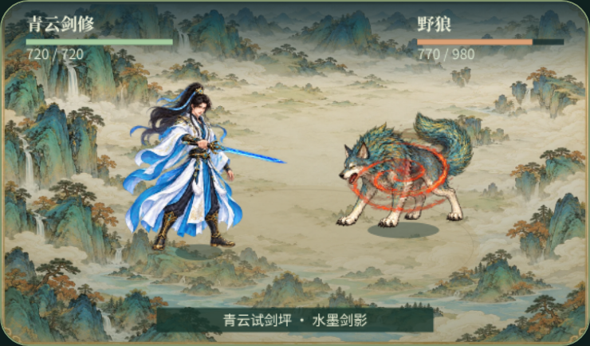
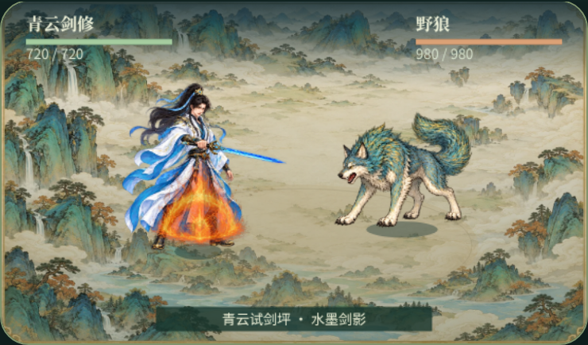

# 火系收尾：流火飞索与炎阳护盾

2026-10-14，基于 main `7f992f9`（V28.68.38）。用户要求先将火系收尾。本轮复用已有的 `flame_bind` 与 `solar_aegis` 原图及八张运行图集，补齐同台战场的状态表现，不重新生成素材、不改战斗公式。本次交付包含运行代码、回归用例及验收记录；腾讯云部署另行进行。

## 修复的问题

两招此前均使用约一秒的短动画，播放结束就消失。试剑坪也没有缠绕或护盾状态，无法验证持续与退出。

流火飞索现在在确认命中且真实减速计数大于零时，在目标躯干显示火索。纹理来自现有聚索图集，固定尺寸、不拉长主体，以 8fps 往返采样；减少动态模式使用固定帧。命中图层最后 40ms 与持续火索交接，普通灼烧微焰仍独立表示灼烧。敌方行动后缠绕到期时火索消失，灼烧仍按原规则继续。冰系也使用相同减速字段，因此冰系施加效果会清除火索的场景来源，不把普通寒迟误画成火索；换目标、死亡、重置、退出同样清理。

炎阳护盾按本场正确玩家的护盾池、剩余回合与元素类型持续显示。四个施放阶段按顺序交接，最后 80ms 与持续盾交接；持续盾复用原主体八帧，以 8fps 往返播放，不缩放角色或改变护盾范围。真实护盾池减少时产生 220ms 的轻微亮度反馈；耗尽或到期时播放 180ms 余焰，随后彻底清除。冰甲覆盖时火盾立即退出，避免两种盾同时显示。隐藏时暂停现有 RAF，恢复前核对状态，后台已失效的盾不补播碎盾。

持续效果复用 `XiantuDuel25D` 的原有绘制循环，没有新增 RAF 或战斗定时器。`readCombatElements` 仅复制基础数值，不暴露可写的 WeakMap 记录；`applyElementHitV286818` 的观察包装在原结算后通知表现层，不修改传入技能或敌人字段。核心战斗模块逐字节保持不变。

## 原机制不变

| 技能 | 耗蓝 | 原机制 |
| --- | ---: | --- |
| 流火飞索 | 35 | 2.4 倍技能伤害；灼烧 2 次主动行动；下一次敌方行动减速 30%、攻击面板降低 15%。不是完全定身。 |
| 炎阳护盾 | 30 | 吸收池为最大气血的 20%，持续敌方 3 次行动；刷新取较大池值，不相加；与冰甲共享元素盾记录。不造成伤害或反伤。 |

预览新增“推进敌方回合”“护盾承伤 30 点”“清除缠绕与护盾”，可独立验证状态。状态仅存在试剑坪内，不读取真实存档。旧 DOM 演武继续使用短动画和减少动态模式命中反馈；本轮持续状态显示的范围是现有 2.5D 同台战场。

## 验证与边界

`QA/v286839-test-fire-finale.cjs` 先记录缺少持续渲染接口的失败，再验证：

- 每层终帧、未命中门槛、已耗尽护盾取消起势、只读绘制。
- 两招正常装备施法，在两种固定随机数下，开启/关闭渲染得到相同战斗状态与 RNG 次数。
- 原耗蓝、减速、攻击衰减、护盾吸收、刷新取最大值、3 回合到期、冰甲替换和玩家身份隔离。
- 同台场景中的持久显示、状态清除后不复活、交接、受击反馈、一次余焰、后台到期及单 RAF。

真实 Chromium 用临时角色执行 `combat('skill',0)`：流火飞索消耗 35 灵力、缠绕 1 次、灼烧 2 次；敌方行动后火索清除，灼烧仍为 2。炎阳护盾消耗 30 灵力、初始吸收池 50（该角色最大气血 250）、3 次行动、对敌伤害 0；第一次承伤后剩余 26，耗尽后不再绘制。无页面脚本错误，重置后场景数为 0。外部服务已阻断，无付费 Jev 请求。

试剑坪在 390×844、844×390、DPR2 下逐招检查，均无横向溢出。真实减少动态设置、缺图情况下的省电轮廓回退，以及旧 DOM 静态模式无 RAF 均通过。实体手机未验证，不能据此宣称真机性能已验收。

完整验证通过：49 组游戏回归、限流测试及 7 项浏览器回归。

相同 Chromium、844×390、DPR2 下，每招 240 次绘制采样：

| 采样 | 修改前 p95 | 修改后 p95 |
| --- | ---: | ---: |
| 流火飞索绘制 | 0.30ms | 0.10ms |
| 炎阳护盾绘制 | 0.20ms | 0.20ms |
| RAF 间隔（60 次） | 16.80ms | 16.70ms |

这是无头浏览器微基准；绘制中位数为 0 受计时精度影响，RAF 间隔不是 GPU 耗时，不能据此宣称性能提升或替代实体手机验证。

测试结果、资源哈希与性能采样见 `art/fire-finale/acceptance.json`。可重放的 Playwright CLI 脚本在 `art/fire-finale/qa/`；修改前服务端口 8772、修改后 8773。原始日志在忽略目录 `output/playwright/fire-finale/`。

## 画面

流火飞索持续状态：

炎阳护盾持续状态：

